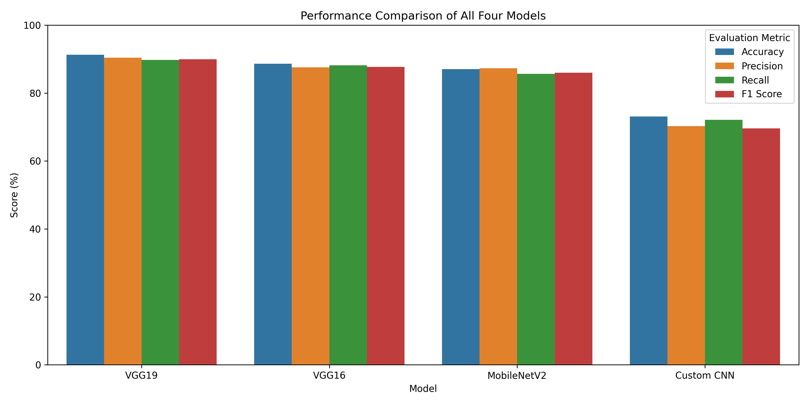
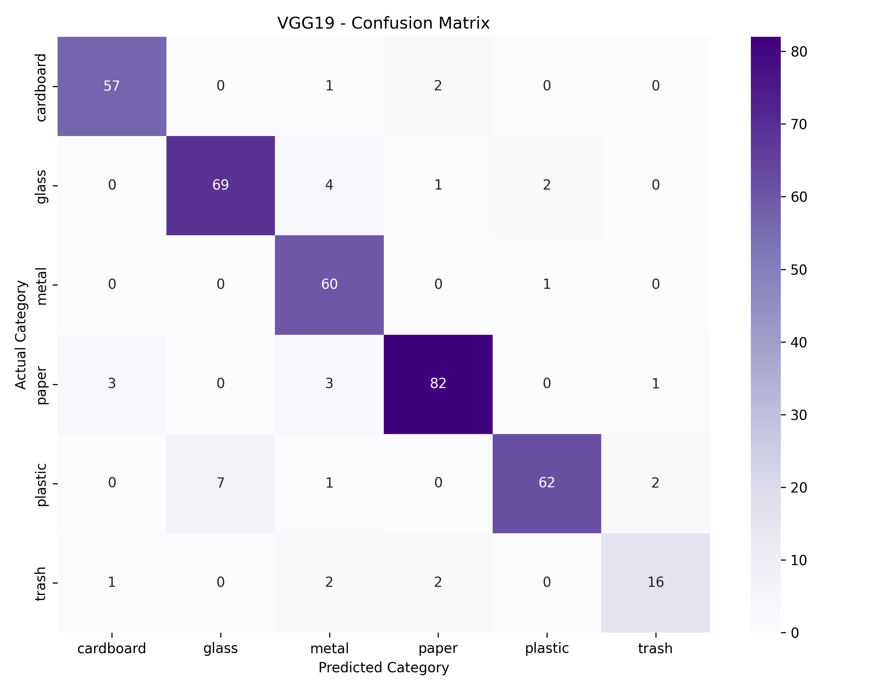

# ♻️ WasteAI — Deep Learning-Based Waste Classification

[](https://wasteai-atchyuteswar.streamlit.app/)

**Live application:** https://wasteai-atchyuteswar.streamlit.app/
**Source code:** https://github.com/Atchyuteswar/WasteAI
**Trained models:** https://huggingface.co/Atchyuteswar/wasteai-models

WasteAI is an academic research prototype that classifies waste images into six dataset categories using deep learning. It compares a custom convolutional neural network with three ImageNet-pretrained architectures and provides a Streamlit dashboard for image inference and model evaluation.

## Project status

- Public GitHub repository: available.
- Four trained inference models: hosted in the public Hugging Face model repository.
- Streamlit application: deployed.
- The four model choices have been tested by the project owner. This README does not imply independent third-party validation.

## Model evaluation

Recorded results from the project's held-out test split:

| Rank | Model | Accuracy | Macro precision | Macro recall | Macro F1 |
|---:|---|---:|---:|---:|---:|
| 1 | **VGG19** | **91.29%** | 90.43% | 89.76% | 89.93% |
| 2 | VGG16 | 88.65% | 87.58% | 88.14% | 87.69% |
| 3 | MobileNetV2 | 87.07% | 87.29% | 85.67% | 86.01% |
| 4 | Custom CNN | 73.09% | 70.27% | 72.12% | 69.62% |

The Stage 2 split contains 1,768 training, 379 validation and 379 test images (2,526 total). The initial Stage 1 manifest counted 2,527 valid images; one image was unavailable during Stage 2 manifest validation. The four model experiments used the saved Stage 2 split.

These metrics describe this experiment's held-out test set. They are not a guarantee of performance on new images or in real-world waste-sorting environments. Per-class classification reports, training curves, confusion matrices and comparison data are available in [`outputs/`](outputs/).

### Selected experiment visuals

**Class distribution**


**Four-model comparison**



**VGG19 confusion matrix**



## Supported categories

- Cardboard
- Glass
- Metal
- Paper
- Plastic
- Trash

The class order used by the classifier is recorded in [`outputs/class_mapping.json`](outputs/class_mapping.json).

## Application features

- Upload JPG, JPEG, PNG or WebP images.
- Select Custom CNN, MobileNetV2, VGG16 or VGG19.
- View the predicted dataset category and score distribution.
- View general disposal guidance.
- Compare accuracy, precision, recall and F1-score.
- Explore training curves, confusion matrices and experiment outputs.
- Load model weights locally or download them from Hugging Face Hub.

## Architecture and model hosting

The repository stores source code, notebooks and experiment outputs. The original dataset and large `.keras` model files are kept outside Git.

The public Hugging Face model repository contains these four inference files:

| Architecture | Hugging Face filename |
|---|---|
| Custom CNN | `cnn_model.keras` |
| MobileNetV2 | `mobilenetv2_model.keras` |
| VGG16 | `vgg16_model.keras` |
| VGG19 | `vgg19_model.keras` |

See [`MODEL_HOSTING.md`](MODEL_HOSTING.md) for upload, configuration and deployment details.

## Run locally

Recommended environment: Python 3.11.

### 1. Clone the repository

```bash
git clone https://github.com/Atchyuteswar/WasteAI.git
cd WasteAI
```

### 2. Create and activate a virtual environment

**Windows PowerShell**

```powershell
py -3.11 -m venv .venv
.\.venv\Scripts\Activate.ps1
```

**macOS / Linux**

```bash
python3.11 -m venv .venv
source .venv/bin/activate
```

### 3. Install dependencies

```bash
python -m pip install --upgrade pip
pip install -r requirements.txt
```

### 4. Configure model hosting

For local development, put the four `.keras` files inside a local `models/` directory. The `models/` directory is intentionally ignored by Git.

Alternatively, configure the Hugging Face repository identifier.

**Windows PowerShell**

```powershell
$env:HF_MODEL_REPO = "Atchyuteswar/wasteai-models"
```

**macOS / Linux**

```bash
export HF_MODEL_REPO="Atchyuteswar/wasteai-models"
```

The app also reads `HF_MODEL_REPO` from Streamlit Secrets. For a public Hugging Face model repository, a token is not required. Do not commit private tokens.

### 5. Launch the app

```bash
streamlit run app.py
```

Open the local URL printed by Streamlit, normally `http://localhost:8501`.

## Deploy / operate the public demo

The public application is deployed at:

https://wasteai-atchyuteswar.streamlit.app/

The application source is in this repository and the model weights are hosted separately on Hugging Face. The Streamlit Secrets configuration uses:

```toml
HF_MODEL_REPO = "Atchyuteswar/wasteai-models"
```

For a public model repository, no Hugging Face access token is required. If you later make the model repository private, configure a read token through Streamlit Secrets only; never place it in source code or Git history.

## Dataset

The project uses the [Garbage Classification dataset on Kaggle](https://www.kaggle.com/datasets/asdasdasasdas/garbage-classification).

The original dataset is not included in this repository. Anyone reproducing the experiments must obtain the dataset independently and review the dataset provider's current terms and license before reuse or redistribution.

## Reproducibility notes

- Stage 2 input size: 224 × 224 × 3.
- Split seed: 42.
- Split ratio: 70% training, 15% validation, 15% testing.
- Class order: cardboard, glass, metal, paper, plastic, trash.
- The Stage 2 configuration and class mapping are stored in `outputs/`.
- Inference preprocessing must match the preprocessing used during training. See the comments in `app.py` and `MODEL_HOSTING.md`.

The CSV files under `outputs/` are experiment metadata. Their `image_path` fields are intended to be portable paths relative to the project root after running the metadata normalization script in `scripts/`. The underlying dataset images are not committed.

## Limitations and responsible use

- WasteAI is an educational research prototype, not a certified waste-sorting system or municipal decision tool.
- The model predicts one of six dataset labels; it does not determine exact material composition, plastic resin code, contamination, or local recyclability.
- Disposal guidance is general. Local recycling rules and facilities differ.
- Softmax scores are model outputs and are not necessarily calibrated probabilities of correctness.
- Test-set metrics may not generalize to images from different environments, cameras, lighting conditions or waste streams.
- Public users should avoid uploading sensitive or private images.

## Citation

If you use or discuss this project, cite the repository:

```text
Atchyuteswar. WasteAI: Deep Learning-Based Waste Classification.
GitHub: https://github.com/Atchyuteswar/WasteAI
```

A machine-readable citation file is provided in [`CITATION.cff`](CITATION.cff).

## License and third-party materials

No project-wide open-source license is declared at this time. Public visibility does not itself grant permission to reuse, modify or redistribute the source code.

The Kaggle dataset and pretrained model assets may have separate terms. Review those terms before selecting a project license or redistributing the dataset or trained weights. See [`docs/LICENSING_REVIEW.md`](docs/LICENSING_REVIEW.md).
