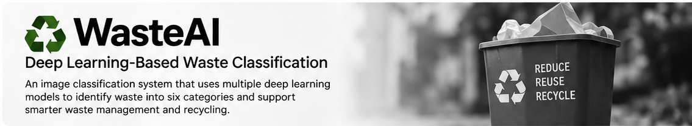
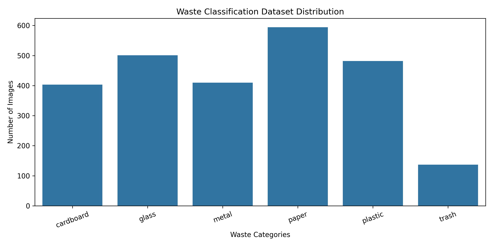
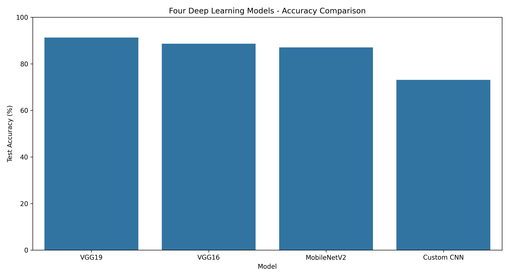
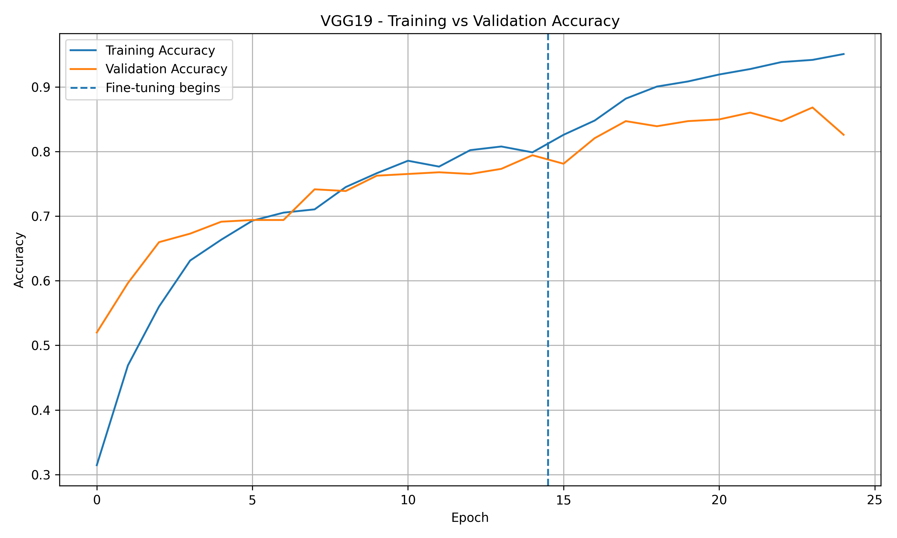
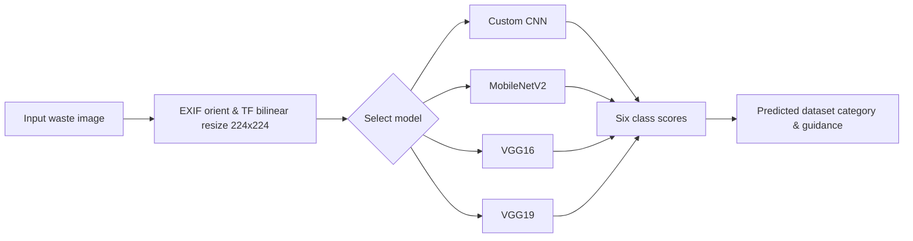

<p align="center">
  
</p>

<p align="center">
  <a href="https://wasteai-atchyuteswar.streamlit.app/"></a>
  <a href="https://github.com/Atchyuteswar/WasteAI/releases/tag/v1.0.0"></a>
  <a href="https://huggingface.co/Atchyuteswar/wasteai-models"></a>
</p>

<p align="center">
  
  
  
  
  
</p>

<h1 align="center">WasteAI</h1>
<p align="center"><strong>Deep learning for image-based waste classification</strong></p>
<p align="center">
  WasteAI classifies waste images into six dataset categories using four deep-learning models and provides a responsive Streamlit application for real-time inference, benchmarking, and training diagnostics.
</p>

<p align="center">
  <a href="https://wasteai-atchyuteswar.streamlit.app/">Launch the app</a> ·
  <a href="https://github.com/Atchyuteswar/WasteAI/releases/tag/v1.0.0">Read the v1.0.0 release</a> ·
  <a href="https://huggingface.co/Atchyuteswar/wasteai-models">Browse trained models</a>
</p>

---

## At a glance

| 4 models | 6 classes | 2,526 images | 91.29% top test accuracy |
|:--:|:--:|:--:|:--:|
| Custom CNN, MobileNetV2, VGG16, VGG19 | Cardboard, Glass, Metal, Paper, Plastic, Trash | 1,768 train · 379 validation · 379 test | VGG19 on the held-out test split |

## Overview

WasteAI is an academic research prototype for image-based waste classification. It compares a custom convolutional neural network trained from scratch against three ImageNet transfer-learning architectures (**MobileNetV2**, **VGG16**, and **VGG19**) and brings model inference, evaluation metrics, and training analytics together in a responsive Streamlit workspace.

### Supported waste categories

<p align="center">
  
</p>

The classifier uses six dataset labels: **Cardboard · Glass · Metal · Paper · Plastic · Trash**. Class-index order is defined in [`outputs/class_mapping.json`](outputs/class_mapping.json).

## Application

Try the live application: **[wasteai-atchyuteswar.streamlit.app](https://wasteai-atchyuteswar.streamlit.app/)**.

The interface is built with native Streamlit components and a dual light/dark theme ([`.streamlit/config.toml`](.streamlit/config.toml)) that adapts across desktop, tablet, and mobile viewports:

| Workspace view | What it contains |
|---|---|
| **Overview** | KPI summary cards, supported material categories, and quick-action navigation |
| **Waste Classifier** | Image upload, architecture selection, top-class and runner-up metrics, disposal guidance, and Altair score distribution chart |
| **Model Performance** | Held-out test benchmark table with visual progress columns and multi-metric comparison chart |
| **Training Analytics** | Cross-model comparison plots, interactive per-epoch accuracy/loss curves, exported plots, and confusion matrices with classification reports |
| **Project Details** | Dataset links, architecture specifications, scope disclosures, and runtime environment diagnostics |

## Model performance

Recorded results from the project's held-out test split:

| Model | Accuracy | Macro precision | Macro recall | Macro F1 | Size |
|---|---:|---:|---:|---:|---:|
| **VGG19** | **91.29%** | 90.43% | 89.76% | 89.93% | 150.03 MB |
| VGG16 | 88.65% | 87.58% | 88.14% | 87.69% | 111.76 MB |
| MobileNetV2 | 87.07% | 87.29% | 85.67% | 86.01% | 22.60 MB |
| Custom CNN | 73.09% | 70.27% | 72.12% | 69.62% | 4.92 MB |

<p align="center">
  
</p>

<details>
  <summary><strong>More evaluation visualizations</strong></summary>

  **Accuracy comparison**

  

  **VGG19 confusion matrix**

  

  **VGG19 training accuracy**

  
</details>

All figures and tabular experiment outputs are stored in [`outputs/`](outputs/). Metrics are from this experiment's held-out test set and should not be interpreted as a guarantee of performance on new real-world images.

## How it works



## Models

| Model | Role in the experiment | Input normalization | Hosted filename |
|---|---|---|---|
| **VGG19** | Highest recorded test accuracy (91.29%) | `tf.keras.applications.vgg19.preprocess_input` | `vgg19_model.keras` |
| **VGG16** | Deep transfer-learning comparison model | `tf.keras.applications.vgg16.preprocess_input` | `vgg16_model.keras` |
| **MobileNetV2** | Lightweight transfer-learning model (22.6 MB) | `tf.keras.applications.mobilenet_v2.preprocess_input` | `mobilenetv2_model.keras` |
| **Custom CNN** | Baseline model trained from scratch (4.9 MB) | Pixel values scaled to `[0, 1]` | `cnn_model.keras` |

The four inference models are hosted in the public [Hugging Face model repository](https://huggingface.co/Atchyuteswar/wasteai-models) rather than committed to Git. See [`MODEL_HOSTING.md`](MODEL_HOSTING.md) for details.

## Dataset and reproducibility

WasteAI uses the [Garbage Classification dataset on Kaggle](https://www.kaggle.com/datasets/asdasdasasdas/garbage-classification). The original image dataset is not included in this Git repository.

| Split | Images | Share |
|---|---:|---:|
| Training | 1,768 | 70% |
| Validation | 379 | 15% |
| Testing | 379 | 15% |
| **Total** | **2,526** | **100%** |

- **Experiment configuration:** 224 × 224 RGB input images, random seed `42`, six classes, and a 70% / 15% / 15% train-validation-test split. Saved configuration metadata is in [`outputs/stage2_config.json`](outputs/stage2_config.json) and portable split CSVs are in [`outputs/splits/`](outputs/splits/).
- **Training/inference parity:** In `app.py`, uploaded images undergo EXIF orientation normalization followed by `tf.image.resize(..., method=ResizeMethod.BILINEAR, antialias=False)` and architecture-specific preprocessing to match the Google Colab training pipeline.
- See [`docs/REPRODUCIBILITY.md`](docs/REPRODUCIBILITY.md) for detailed pipeline and evaluation notes.

## Quick start

**Requirements:** Python 3.11 is recommended. Dependencies are listed in [`requirements.txt`](requirements.txt).

### 1. Clone the repository

```bash
git clone https://github.com/Atchyuteswar/WasteAI.git
cd WasteAI
```

### 2. Create an environment and install dependencies

**Windows PowerShell**

```powershell
py -3.11 -m venv .venv
.\.venv\Scripts\Activate.ps1
python -m pip install --upgrade pip
pip install -r requirements.txt
```

**macOS / Linux**

```bash
python3.11 -m venv .venv
source .venv/bin/activate
python -m pip install --upgrade pip
pip install -r requirements.txt
```

### 3. Configure model access

For local development, place the four `.keras` files in a local `models/` directory (excluded from Git).

Alternatively, download models on demand from the public Hugging Face repository by setting `HF_MODEL_REPO`:

**Windows PowerShell**

```powershell
$env:HF_MODEL_REPO = "Atchyuteswar/wasteai-models"
```

**macOS / Linux**

```bash
export HF_MODEL_REPO="Atchyuteswar/wasteai-models"
```

On Streamlit Community Cloud, add this to the app's **Settings → Secrets**:

```toml
HF_MODEL_REPO = "Atchyuteswar/wasteai-models"
```

The repository is public, so a Hugging Face token is not required for downloads. Never commit access tokens or `secrets.toml`.

### 4. Run WasteAI

```bash
streamlit run app.py
```

Open the local address printed by Streamlit, usually `http://localhost:8501`.

## Repository structure

```text
WasteAI/
├── app.py
├── requirements.txt
├── Waste_Classification_Stage_1.ipynb
├── MODEL_HOSTING.md
├── CITATION.cff
├── .streamlit/
│   └── config.toml
├── .github/
│   └── workflows/
│       └── keep-streamlit-alive.yml
├── assets/
│   └── wasteai-banner.png
├── docs/
│   ├── LICENSING_REVIEW.md
│   └── REPRODUCIBILITY.md
└── outputs/
    ├── class_mapping.json
    ├── class_weights.json
    ├── stage2_config.json
    ├── dataset_manifest.csv
    ├── final_model_comparison.csv
    ├── training_time_comparison.csv
    ├── experimental_conclusion.txt
    ├── splits/
    │   ├── train.csv
    │   ├── validation.csv
    │   └── test.csv
    └── model curves, confusion matrices, and reports
```

Large model weights (`models/`) and the raw image dataset (`dataset/`) are stored separately and excluded from Git. A scheduled GitHub Actions workflow ([`.github/workflows/keep-streamlit-alive.yml`](.github/workflows/keep-streamlit-alive.yml)) periodically pings the deployed Streamlit Community Cloud app to prevent inactivity sleep.

## Responsible use and limitations

- WasteAI is an **educational research prototype**, not a certified waste-sorting, recycling, or municipal decision system.
- The model predicts one of six dataset labels. It does not identify exact material composition, plastic resin codes, contamination levels, or local recyclability.
- Disposal guidance is general; always follow the rules of local recycling services.
- Softmax outputs are model scores and are not necessarily calibrated probabilities of correctness.
- Held-out test performance may not generalize to new cameras, lighting, backgrounds, objects, or waste streams.
- Avoid uploading sensitive or private images to the public demo.

## License and third-party materials

No project-wide open-source license has been declared. Public availability of this repository does not by itself grant permission to reuse, modify, or redistribute its contents. The Kaggle dataset, pretrained weights, and dependencies may have their own terms; review them before redistribution. See [`docs/LICENSING_REVIEW.md`](docs/LICENSING_REVIEW.md).

## Citation

If you reference this project, please cite the repository:

```text
Atchyuteswar. WasteAI: Deep Learning-Based Waste Classification.
https://github.com/Atchyuteswar/WasteAI
```

Machine-readable citation metadata is available in [`CITATION.cff`](CITATION.cff).

## Links

- **Live application:** https://wasteai-atchyuteswar.streamlit.app/
- **GitHub repository:** https://github.com/Atchyuteswar/WasteAI
- **v1.0.0 release:** https://github.com/Atchyuteswar/WasteAI/releases/tag/v1.0.0
- **Hugging Face models:** https://huggingface.co/Atchyuteswar/wasteai-models

---

<p align="center"><strong>WasteAI v1.0.0 · Built by Atchyuteswar Gottumukkala</strong></p>
<p align="center"><sub>Classify thoughtfully. Recycle responsibly. ♻️</sub></p>
